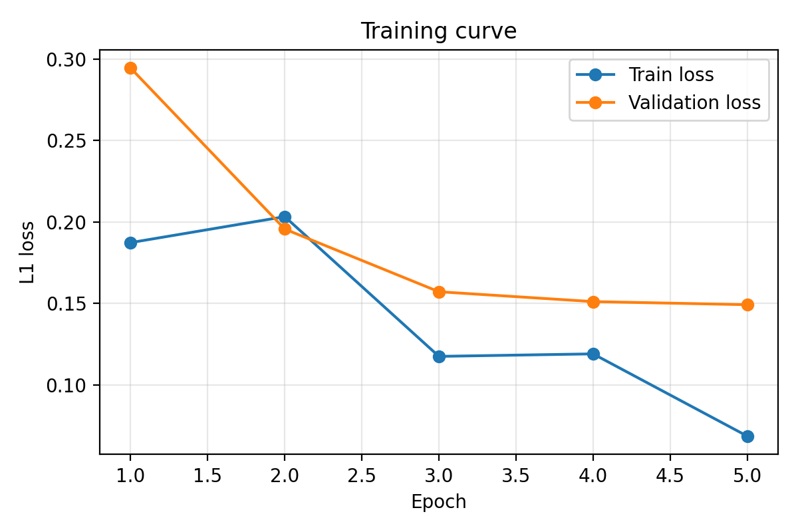

# Underwater Depth Estimation

This project fits the **UVMulti** underwater dataset into the **Depth Anything (small)** model and fine-tunes it with **LoRA** (parameter-efficient fine-tuning).


## 1. Task
**Monocular depth estimation:** given a single RGB image, predict a depth map that gives how far each point is from the camera. 

Underwater images are hard for models trained on land scenes because of light absorption, haze and colour cast, so we fine-tune a pretrained model on underwater data.

## 2. Dataset
[UVMulti](https://doi.org/10.6084/m9.figshare.30105151) is an underwater video benchmark. Each `videoN/` folder contains:
- `images/`: RGB frames
- `depth/`, `dense_depth/`: depth maps
- `mask/`, `sequence/`, `sequence_enh/`: not used

We use `images/` as input and `<depth or dense_depth>/` as ground truth.

 we have **233 image/depth pairs**, split randomly **80% training (186) / 20% validation (47)**.

## 3. Model
we used **`LiheYoung/depth-anything-small-hf`** pre-trained model which is loaded from Hugging Face. It has two parts:
- **Encoder:** a Vision Transformer (ViT-S) that turns the image into feature tokens through self-attention layers.
- **Decoder head (DPT-style):** combines features from several encoder layers and upsamples them into a depth map.

It was pretrained on a very large set of mostly land images, so it already understands scene geometry.We have trained it on underwater images so it can adapt to underwater images too.

## 4. Training pipeline

**Step 1: Data loading (`Dataset.py`)**
- Image: opened as RGB, resized to **518x518**, converted to a tensor with values in 0-1.
- Depth: loaded as a float array, resized to 518x518, then **min-max normalised to 0-1**.
- Each item is returned as `(image, depth)`.

**Step 2: Split and batching (`run_training.py`)**
- `random_split` into train/validation (80/20), with a `DataLoader` of batch size **4** .

**Step 3: LoRA setup (`Model.py`)**
- The pretrained weights are frozen.
- Small trainable low-rank matrices are added to the **query** and **value** projections of every attention layer.
- LoRA settings: rank **16**, alpha **32**, dropout **0.001**`.
- Trainable parameters: **304,128 of 25,080,001 (1.21%)**, so far fewer weights are updated than in full fine-tuning.

**Step 4: Training loop (`Training.py`)**

For each epoch and each batch:
1. Forward pass: the images go through the model and give a predicted depth map `(B, 518, 518)`.
2. Loss: **L1 loss** (mean absolute error) between the predicted and real depth, and take average over all pixels : `loss = mean(|pred - gt|)`.
3. Backward pass: gradients are computed for the trainable weights only.
4. `AdamW` step updates LoRA and decoder weights.
5. The learning rate is set manually at every iteration with a scheduler.

**Step 5: Validation (after every epoch)**
- we compute the L1 loss on the validation split with no gradient updates.
- All evaluation metrics (section 5) are also computed and logged to Weights & Biases (offline mode).
- A checkpoint (`.pth` with model and optimizer state) is saved whenever the validation loss improves.

**Training settings**

| Setting | Value |
|---|---|
| Base model | depth-anything-small-hf |
| Fine-tuning | LoRA (r=16, alpha=32, dropout=0.001) on query and value |
| Loss | L1 |
| Optimizer | AdamW |
| Peak / min learning rate | 1e-3 / 1e-7 |
| LR schedule | 30% linear warmup, then cosine decay |
| Epochs | 5 |
| Batch size | 4 |
| Gradient clipping | 1.0 (configured) |
| Image size | 518 x 518 |

## 5. Evaluation metrics
For evaluation, the predicted depth is upsampled to the image size and compared to the ground truth per image. The values are then averaged over the dataset. Here `d` is the ground-truth depth, `d̂` the predicted depth, and `n` the number of pixels.

**Error metrics (lower is better)**

| Metric | Formula | What it tells you |
|---|---|---|
| AbsRel | `mean(\|d - d̂\| / d)` | Average error relative to the true depth, so it treats near and far pixels fairly |
| SqRel | `mean((d - d̂)² / d)` | Like AbsRel but punishes large errors more |
| RMSE | `sqrt(mean((d - d̂)²))` | Typical error in depth units, dominated by large mistakes |
| RMSE-log | `sqrt(mean((log d - log d̂)²))` | RMSE in log space, so errors on near objects matter as much as on far ones |
| log10 | `mean(\|log10 d - log10 d̂\|)` | Average error in orders of magnitude |
| SiLog | `mean(e²) - mean(e)²`, where `e = log d̂ - log d` | Scale-invariant error. It ignores a global scale shift and measures whether the depth structure is right |

**Accuracy metrics (higher is better)**

| Metric | Definition | What it tells you |
|---|---|---|
| δ1 (`a1`) | fraction of pixels with `max(d/d̂, d̂/d) < 1.25` | Share of pixels predicted within 25% of the truth |
| δ2 (`a2`) | same with threshold `1.25²` | Looser accuracy |
| δ3 (`a3`) | same with threshold `1.25³` | Loosest accuracy |


## 6. Results
Loss over 5 epochs:



| Epoch | Train loss | Validation loss |
|---|---|---|
| 1 | 0.187 | 0.294 |
| 2 | 0.203 | 0.196 |
| 3 | 0.118 | 0.157 |
| 4 | 0.119 | 0.151 |
| 5 | 0.069 | 0.149 |

Both losses decrease, which shows the model is training on the new dataset. Before-vs-after metrics are in `results/metrics_comparison.csv`.

training and evaluation logs are stored in `depth_estimation/eval_logs.txt and depth_estimation/train_log.txt`.


## 7. Project structure
```
Dataset.py          # dataset classes (UVMultiDataset added)
Model.py            # loads Depth Anything + applies LoRA
Training.py         # training loop (L1 loss, warmup + cosine LR, checkpointing)
Evaluation.py       # computes depth metrics per batch
utils/metrices.py   # metric functions
run_training.py     # start training
run_evaluation.py   # evaluate before vs after training
make_report.py      # creates plots and tables in results/
results/            # loss curve, metrics, sample predictions, logs
```

## 8. run
```
pip install -r requirements.txt
python run_training.py > train_log.txt 2>&1
python run_evaluation.py > eval_log.txt 2>&1

```
